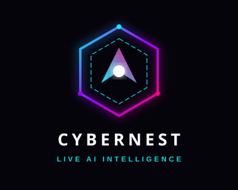

  

# CYBERNEST

**Live AI Intelligence.** CYBERNEST is a provider-agnostic TypeScript toolkit for building AI-powered applications and agents.

- Animated logo: [`assets/logo-animated.html`](assets/logo-animated.html) (open in a browser)
- Core package docs: [`packages/ai/README.md`](packages/ai/README.md)

## Attribution

This project is built on the open-source [Vercel AI SDK](https://github.com/vercel/ai), licensed under the Apache License 2.0. See [`LICENSE`](LICENSE). Package names (`ai`, `@ai-sdk/*`) are unchanged for compatibility.
